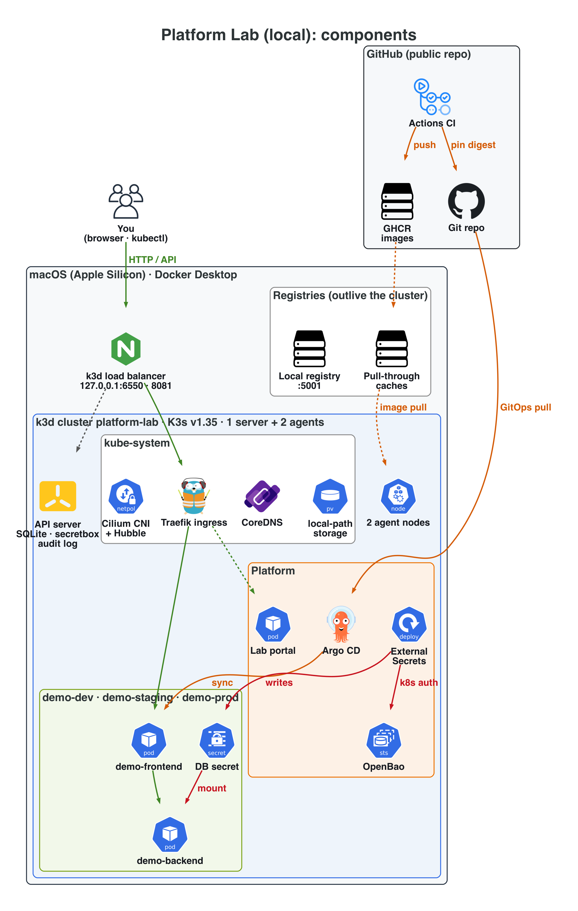
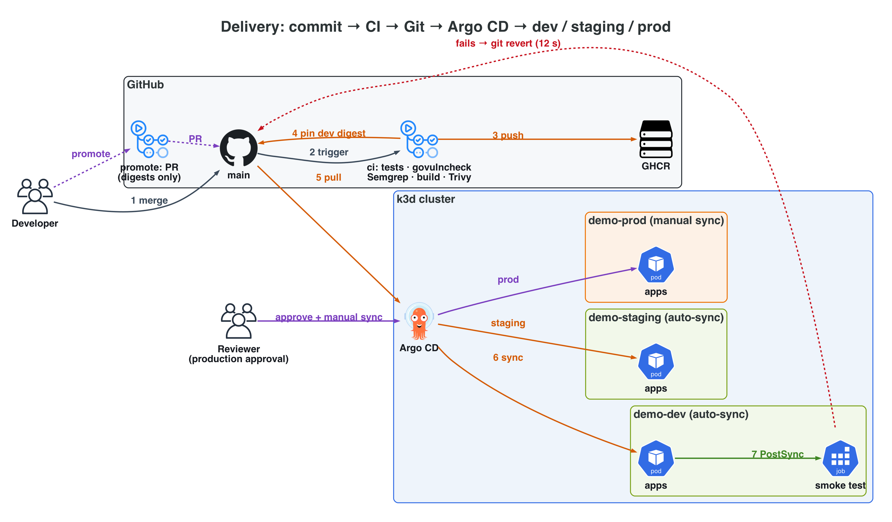
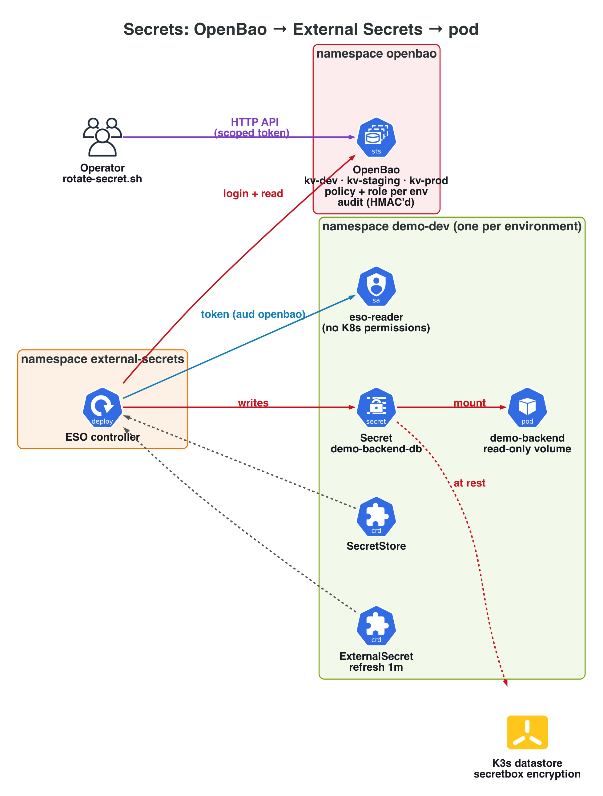
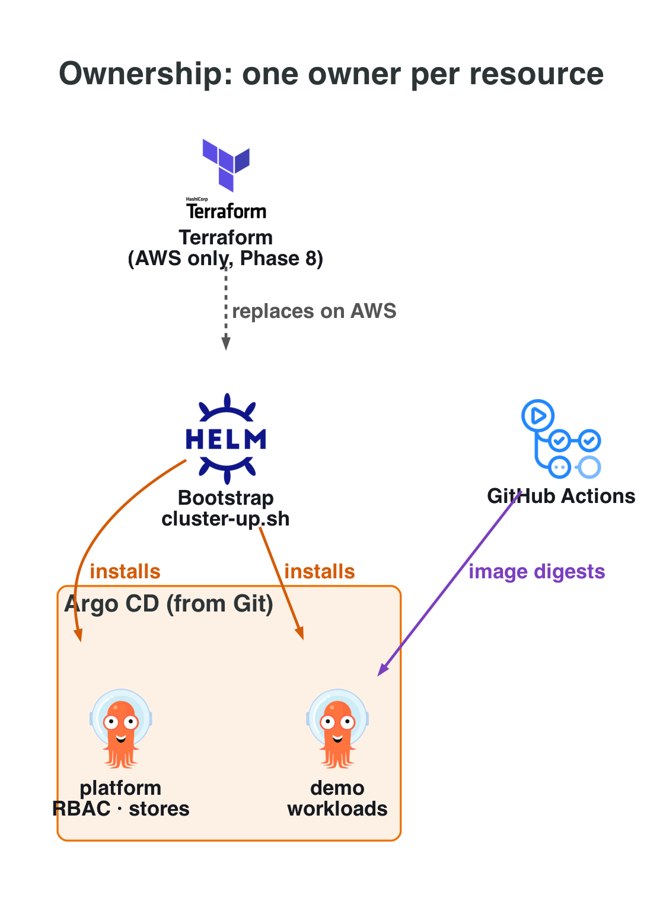

# Architecture

Local, production-inspired platform on k3d (Apple Silicon), with GitHub as the
source of truth and an AWS/EKS design to follow in Phase 8. Versions are pinned
in [`local/versions.env`](../local/versions.env). Every endpoint is linked from
the lab portal, **http://lab.localhost:8081**. The AWS/EKS target design is in
[aws-architecture.md](aws-architecture.md).

Diagrams are generated from code ([`docs/diagrams/local_architecture.py`](diagrams/local_architecture.py)).
Click a diagram for full resolution. Tools without an icon in the diagram
library (Cilium, OpenBao, k3d) use the Kubernetes icon for what they run as,
with the tool named in the label.

## 1. Components

| Layer | Tool | Why (decision record) |
|---|---|---|
| Cluster | k3d + K3s v1.35.5, single server, SQLite | Survives Docker IP changes that broke the 3-server etcd `dev-cluster` ([0001](decisions/0001-single-server-topology.md)) |
| CNI / network policy | Cilium 1.20 (kube-proxy kept), Hubble | L3–L7 and FQDN policy for Phase 6 ([0002](decisions/0002-cilium-cni.md)) |
| Ingress | Traefik (bundled) via NodePort, loopback only | ingress-nginx retired; no hostPort under Cilium ([0003](decisions/0003-ingress-traefik-nodeport.md)) |
| Images | Local registry + pull-through caches; GHCR for CI output | Rebuilds in ~30s; one approved source ([0004](decisions/0004-local-registry.md)) |
| Manifests | Kustomize (first-party), pinned Helm charts (third-party) | One tool per ownership type ([0005](decisions/0005-manifest-tooling-and-layout.md)) |
| Tenancy | Restricted Pod Security, LimitRange, ResourceQuota | Built-in guardrails before Kyverno ([0006](decisions/0006-namespace-baseline.md)) |
| Identity | x509 personas (24h), group RBAC, impersonation break-glass, audit log | Real authentication, least privilege ([0007](decisions/0007-human-identity-and-break-glass.md), [IAM model](iam-model.md)) |
| Secrets | OpenBao + External Secrets, secretbox at rest | Store-agnostic delivery; on AWS only the provider changes ([0008](decisions/0008-secrets-architecture.md), [secrets model](secrets-model.md)) |
| Delivery | GitHub Actions (CI) + Argo CD (CD), digest promotion | One owner per resource; tested bytes ship ([0009](decisions/0009-gitops-ownership.md)) |

## 2. GitOps flow: commit to prod, and rollback

## 3. Secrets flow

## 4. Ownership layers (no resource has two owners)

## 5. Local vs AWS (target for Phase 8)

| Concern | Local lab | AWS |
|---|---|---|
| Control plane | K3s single server (SQLite) | EKS managed, multi-AZ |
| Nodes | 2 k3d agents (containers) | Managed node groups / Karpenter, Graviton (arm64 images already built) |
| CNI | Cilium (tunnel) | VPC CNI (+ Cilium chaining optional), security groups for pods |
| Ingress | Traefik NodePort on 127.0.0.1 | AWS Load Balancer Controller → ALB, ACM TLS |
| Registry | GHCR + local caches | ECR (+ pull-through cache rules), scan on push |
| Human access | x509 personas, impersonation break-glass | IAM Identity Center → IAM roles → EKS access entries; MFA break-glass role |
| Workload → cloud | none | EKS Pod Identity |
| CI identity | `GITHUB_TOKEN` | GitHub OIDC → STS role (ECR push only) |
| Secrets | OpenBao + ESO | Secrets Manager + ESO (Pod Identity), KMS CMK per environment |
| Encryption at rest | secretbox, key on the server's disk | EKS envelope encryption with KMS |
| Audit | API audit log on server-0, OpenBao audit stdout | EKS control-plane logs → CloudWatch, CloudTrail |
| Delivery | Argo CD from GitHub | same |
