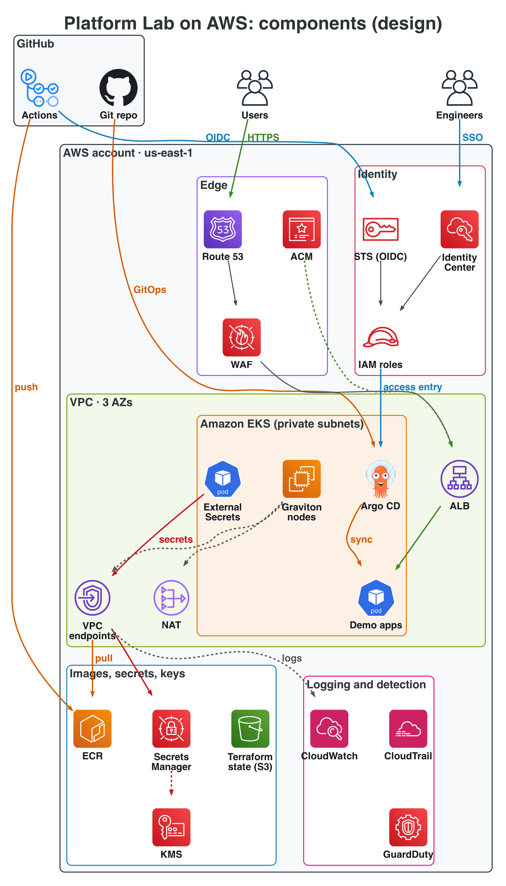
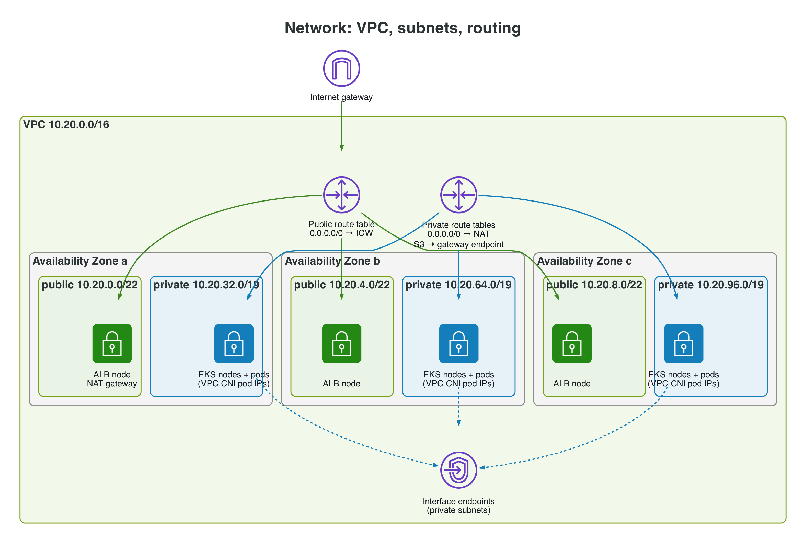
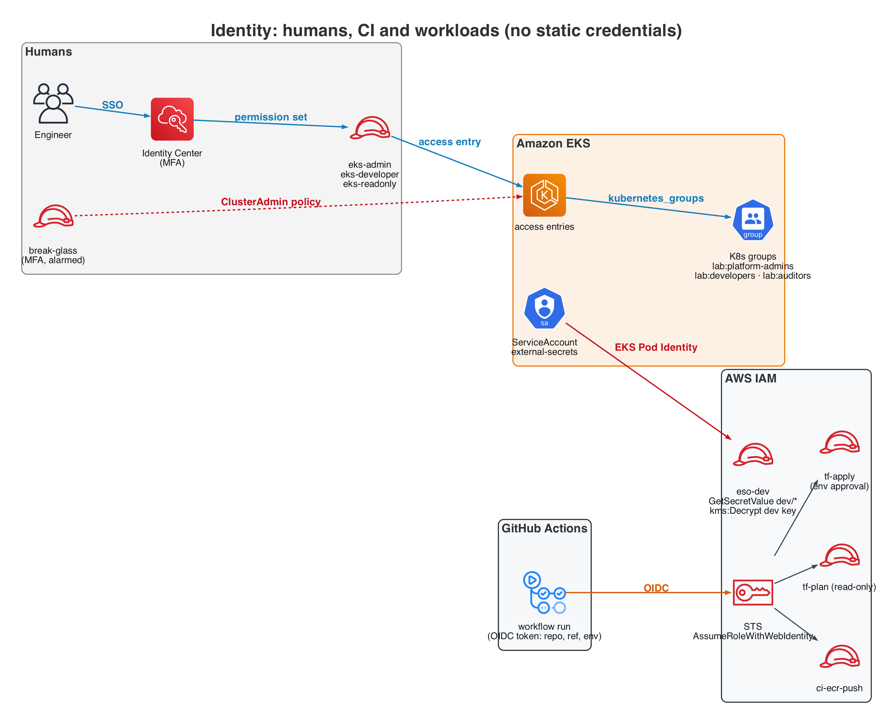
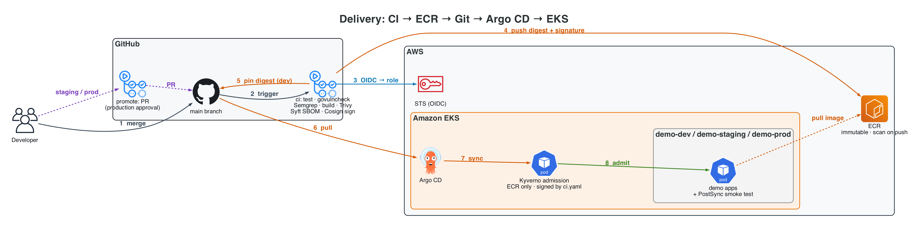
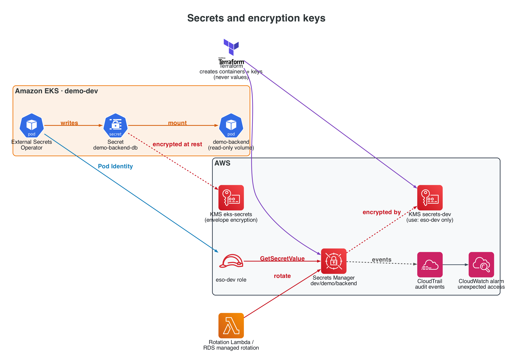
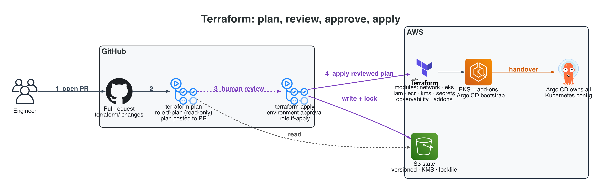

# AWS Architecture (EKS): design for Phase 8

> **Status: design only.** No AWS resources exist. Nothing is created until the
> AWS phase is explicitly approved. Terraform modules (`terraform/`) implement
> this design in Phase 8, and every `apply` goes through a reviewed plan.

The same platform as the [local lab](architecture.md), mapped to managed AWS services.
Diagrams use the official AWS architecture icons and are generated from code
([`docs/diagrams/aws_architecture.py`](diagrams/aws_architecture.py)). Click a diagram for full resolution.
Kubernetes-level components (Argo CD, External Secrets, Kyverno, and the demo app
manifests) are **identical**. What changes is identity, networking, storage of
secrets and keys, ingress, and logging.

## 1. Components

## 2. Network and routing

| Security group | Inbound | Outbound |
|---|---|---|
| `alb` | 443 from 0.0.0.0/0 (or WAF/CloudFront prefix list) | target port to `nodes` |
| `nodes` | from `alb` on target ports; node-to-node all (CNI); control plane on 443/10250 | 443 to endpoints and NAT |
| `cluster` (EKS-managed) | 443 from `nodes` | 10250/443 to `nodes` |
| `vpc-endpoints` | 443 from `nodes` | — |
| Pods (optional, SG-for-pods) | per workload, e.g. backend only from frontend pods | per workload |

- Nodes and pods have **no public IPs**. The EKS API endpoint is **private + public restricted to an allow-list CIDR**, and private-only once a VPN or bastion exists.
- `dev` uses **one NAT gateway** (cost). `staging`/prod use one per AZ (availability).
- Kubernetes NetworkPolicy is enforced by the **VPC CNI network policy agent** (eBPF). Phase 6 policies carry over unchanged. Cilium's L7/FQDN policies don't; their AWS equivalents are security groups for pods plus egress through NAT and endpoints only.

## 3. Identity

| Local lab | AWS |
|---|---|
| x509 persona certs (24h) | Identity Center SSO → role session (1–12h) |
| Group in cert `O=` | `kubernetes_groups` on the access entry |
| Impersonation break-glass | Separate MFA role + access entry, CloudTrail alarm on use |
| `system:masters` bootstrap kubeconfig | `bootstrap_cluster_creator_admin_permissions = false`; admin only via access entry |
| `GITHUB_TOKEN` (GHCR) | GitHub OIDC → STS, no access keys anywhere |
| ESO → OpenBao Kubernetes auth | ESO → **Pod Identity** → Secrets Manager |

## 4. GitOps and supply chain on EKS

## 5. Secrets and keys

The same `ExternalSecret` manifests as locally. Only the `SecretStore` provider changes:
`aws: {service: SecretsManager, region: us-east-1}` with no static credentials, since Pod Identity supplies them.

## 6. Terraform layout and ownership

| Owner | Resources | Never owns |
|---|---|---|
| **Terraform** | VPC, subnets, routes, SGs, endpoints, EKS + node groups + add-ons, IAM roles/policies, access entries, Pod Identity associations, KMS, ECR, Secrets Manager *containers*, log groups, Argo CD Helm release + root app | Kubernetes app config, secret values |
| **Argo CD** | Namespaces, RBAC, Kyverno policies, SecretStores/ExternalSecrets, workloads | Anything in AWS |
| **GitHub Actions** | Images in ECR, dev digest pins, promotion PRs, Terraform runs (via roles) | Long-lived credentials |

## 7. Security controls

| Control | AWS implementation |
|---|---|
| Encryption at rest | KMS CMKs: EKS Secrets, EBS (gp3), ECR, Secrets Manager, CloudWatch Logs, S3 state |
| Encryption in transit | ALB TLS (ACM), VPC endpoints (TLS), API server TLS |
| Least privilege | Role per function, `aws:SourceIdentity`/session tags, permission boundaries for `tf-apply` |
| No static credentials | Identity Center, GitHub OIDC, Pod Identity; SCP denying `iam:CreateAccessKey` |
| Admission | Kyverno (ECR-only registry, Cosign signature by `ci.yaml@main`, limits, labels) + Pod Security `restricted` |
| Runtime detection | GuardDuty EKS Runtime Monitoring (managed) or Falco DaemonSet (same rules as local) |
| Audit | EKS `api`, `audit`, `authenticator` logs → CloudWatch; CloudTrail for every AWS API call |
| Network | Private nodes, SGs, NetworkPolicy (VPC CNI), endpoints, optional WAF on the ALB |
| Image hygiene | ECR scan on push + Trivy in CI, immutable tags, lifecycle policy |

## 8. Cost estimate (dev, us-east-1, on-demand list prices; verify in the AWS Pricing Calculator before approval)

| Item | Sizing | ≈ USD / month |
|---|---|---|
| EKS control plane | 1 cluster × $0.10/h | 73 |
| Nodes | 2 × t4g.medium (Graviton) | 49 |
| EBS | 2 × 30 GiB gp3 node volumes + 10 GiB PVs | 6 |
| NAT gateway | 1 × $0.045/h + data processing | 33 + data |
| ALB | 1 ALB + low LCU | 18 |
| VPC interface endpoints | 6 endpoints × 1 AZ (dev) × $0.01/h | 44 |
| KMS | 4 keys | 4 |
| Secrets Manager | ~5 secrets | 2 |
| CloudWatch Logs | ~5 GiB ingest (control-plane audit is chatty) | 3–10 |
| Route 53 + ACM | hosted zone (ACM public certs are free) | 1 |
| ECR | < 5 GiB | < 1 |
| **Total (dev, running 24/7)** | | **≈ $235–250 + data transfer** |

Cost levers: stop node groups outside lab hours (scale to 0); drop interface
endpoints in dev and route through NAT (−$44, less private); use Spot for nodes;
**tear down when idle**, since the control plane alone is ~$2.40/day.
Staging with NAT and endpoints in 3 AZs adds about $120/month on top of dev.

## 9. Teardown order (Phase 8 runbook)

1. Argo CD: delete the `demo-*` Applications (finalizers remove workloads and their ALB-backed Ingresses).
2. Confirm the AWS Load Balancer Controller has removed every ALB and target group: `aws elbv2 describe-load-balancers`. Orphaned ALBs block VPC deletion.
3. Delete PVCs (EBS volumes) or confirm their reclaim policy.
4. `terraform destroy` in `environments/dev` (add-ons → node groups → EKS → endpoints → NAT → VPC).
5. KMS keys enter a **7–30 day pending deletion** window: schedule deletion deliberately, never automatically.
6. Keep the state bucket until the final destroy is verified, then empty it and delete it.
7. Verify zero cost: Cost Explorer filtered on the `project=platform-lab` tag the next day.

## 10. Local lab → AWS mapping

| Concern | Local | AWS |
|---|---|---|
| Control plane | K3s single server | EKS managed, multi-AZ |
| Nodes | k3d agent containers | Managed node group, Graviton |
| CNI / policy | Cilium | VPC CNI + network policy agent |
| Ingress | Traefik NodePort on 127.0.0.1 | AWS LB Controller → ALB + ACM + WAF |
| DNS | `*.lab.localhost` | Route 53 |
| Registry | GHCR + pull-through caches | ECR + pull-through cache rules |
| Human access | x509 personas, impersonation break-glass | Identity Center → roles → access entries |
| Workload identity | ServiceAccount tokens (OpenBao auth) | EKS Pod Identity |
| CI identity | `GITHUB_TOKEN` | GitHub OIDC → STS |
| Secrets | OpenBao + ESO | Secrets Manager + ESO |
| Keys | secretbox key on the server's disk, Shamir unseal | KMS CMKs (HSM-backed, audited) |
| Storage | local-path (node-local) | EBS CSI gp3 (AZ-bound) |
| Audit | API audit file, OpenBao audit stdout | CloudWatch EKS logs, CloudTrail |
| Runtime detection | Falco | GuardDuty EKS Runtime or Falco |
| Delivery | Argo CD from GitHub | same |
